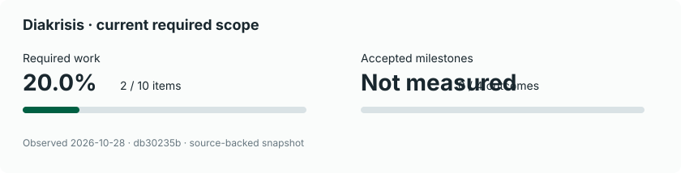

# diakrisis

**Distinguish before you judge.**

A local-first, evidence-aware collection of portable Agent Skills for reviewing conceptual structures, terminology, reasoning, research methods, and written communication.

**Status: seven coordinated experimental skills implemented on `main`.** Package `0.1.0-dev.0` remains unreleased. Structural checks pass; an experimental consumer source integration exists in Writing Kitchen, while host activation, consumer CI resolution and behavioral review evaluations remain pending. No skill output is automatically authoritative, and no review grants an agent permission to publish, merge, or alter another repository.

## Project tracker

<!-- project-record:start -->

| Measure | Completion | Meaning |
| --- | ---: | --- |
| Required work | 2/10 · 20.0% | Completed leaf items in the named required scope. |
| Accepted milestones | 0/4 · Not measured | Milestones whose declared outcome gates passed. |

Source file: `progress/ledger.json` (content-addressed file snapshot).

Observed 2026-10-27 against `235cff8c`.

#### Milestone roadmap

| Milestone | Horizon | Supporting required work | Outcome acceptance | Next gate |
| --- | --- | ---: | --- | --- |
| **DIA-M0 — Documented basis** | Now | 1/1 · 100.0% | Unknown / not assessed | Review the documented foundation and its source authority (work 1/1; acceptance still unknown). |
| **DIA-M1 — Reproducible foundation** | Now | 1/4 · 25.0% | Unknown / not assessed | DIA-005 / #5 finding+report contract structurally implemented: revision 1 in PR #24, revision 2 in PR #41 (2026-10-27), with positive, negative and abstention cases. DIA-003 complete; DIA-002 / #2 remains the P0 prerequisite Blocked only for owner-deferred local archive/runtime verification. DIA-004 / #4 runtime activation is also deferred. No further eligible unblocked completion gate in M1 until owner resumes the final test phase; M1 acceptance remains unknown. |
| **DIA-M2 — Evaluated reviewers** | Next | 0/2 · 0.0% | Unknown / not assessed | Adjudicate blinded reviewer-vs-baseline runs including negative controls. |
| **DIA-M3 — Portable system** | Later | 0/3 · 0.0% | Unknown / not assessed | DIA-009 / #9 private consumer Actions blocker isolated to **no runner allocated** (runner_id 0, zero steps) for Writing Kitchen and Spatial Laboratory, including before Diakrisis integration. Owner confirmed 2026-10-27 that monthly private Actions usage is exhausted and declined extra spending; retry once the quota renews, and meanwhile run consumer checks offline. Spatial Laboratory PR #18 still needs explicit owner merge approval. DIA-008 coordinator and DIA-010 offline bundle structurally implemented; DIA-007 behavior/consumer verification and stable release gates deferred. M3 acceptance unknown. |

#### Work packages

States represent recorded implementation progress; a closed issue, passing test or accepted milestone is not automatically interchangeable.

| ID / issue | Work package | State | Priority | Dependencies | Evidence or next action |
| --- | --- | --- | --- | --- | --- |
| [DIA-001](https://github.com/interzettel/diakrisis/issues/1) | Preserve research foundation | Done | P0 | — | [PR #11](https://github.com/interzettel/diakrisis/pull/11) |
| [DIA-002](https://github.com/interzettel/diakrisis/issues/2) | Install and verify Project Record Standard | In progress | P0 | DIA-001 | [PR #15](https://github.com/interzettel/diakrisis/pull/15) · Blocked flag (reason in source) |
| [DIA-003](https://github.com/interzettel/diakrisis/issues/3) | Audit upstream standards and donors | Done | P0 | DIA-001 | [PR #20](https://github.com/interzettel/diakrisis/pull/20) |
| [DIA-004](https://github.com/interzettel/diakrisis/issues/4) | Activate pinned authoring tools | Planned | P1 | DIA-003 | Portable Superpowers/skill-creator/PRS install and discovery verified in an actual Claude Code or Codex session, including rollback. |
| [DIA-005](https://github.com/interzettel/diakrisis/issues/5) | Define typed findings and authority contract | In progress | P1 | DIA-002, DIA-003 | [PR #24](https://github.com/interzettel/diakrisis/pull/24) |
| [DIA-006](https://github.com/interzettel/diakrisis/issues/6) | Build and test three pilot reviewers | In progress | P1 | DIA-004, DIA-005 | [PR #17](https://github.com/interzettel/diakrisis/pull/17) |
| [DIA-007](https://github.com/interzettel/diakrisis/issues/7) | Evaluate pilots on genuine documents | In progress | P1 | DIA-006 | [PR #46](https://github.com/interzettel/diakrisis/pull/46) |
| [DIA-008](https://github.com/interzettel/diakrisis/issues/8) | Expand reviewers and coordination | In progress | P2 | DIA-007 | [PR #27](https://github.com/interzettel/diakrisis/pull/27) |
| [DIA-009](https://github.com/interzettel/diakrisis/issues/9) | Adopt framework in consumer repositories | In progress | P2 | DIA-007 | [writing-kitchen PR #24](https://github.com/yigit-denktas/writing-kitchen/pull/24) · Blocked flag (reason in source) |
| [DIA-010](https://github.com/interzettel/diakrisis/issues/10) | Version releases and evaluate drift | In progress | P2 | DIA-008, DIA-009 | [PR #26](https://github.com/interzettel/diakrisis/pull/26) |

**Versioning:** Suite `0.1.0-dev.0` — **unreleased**; included skills: **7**. Draft candidates: None. [Single package version policy](docs/VERSIONING.md).

**Source coverage:** observed **2026-10-27**, authoritative [ledger](progress/ledger.json), [manifest](progress/project-record.json), [scope history](progress/history/2026-10-26-unapproved.json). Regeneration does not fetch newer issues or change the observation date.

**Counts:** required work **2/10 · 20.0%**; retained work **2/10 · 20.0%**; accepted milestones **Unknown** (0 of 4 determinate).

<!-- project-record:end -->

## Why it exists

A grammatically impeccable assertion can still misuse a term, confuse a state with a class, conceal an unsupported inference, or contradict an accepted research method. Diakrisis is designed to help researchers, writers, and coding agents **find and explain** those problems without silently replacing their judgment.

## Intended consumers

- [Writing Kitchen](https://github.com/yigit-denktas/writing-kitchen): optional critique of drafts, with voice and authorship preserved.
- [Spatial Laboratory](https://github.com/yigit-denktas/spatial-laboratory): evidence-aware critique of study contracts, evaluations, and research reports.
- [Project Record Standard](https://github.com/interzettel/project-record-standard): audit terminology, conceptual types, state/flag distinctions, and project claims.
- [Personal Agent Stack](https://github.com/interzettel/personal-agent-stack): reusable typed judgments without granting agents new authority.

These are integration targets, **not completed integrations**. Consumer repositories retain their own policies, canonical sources, and approval gates.

## Review capabilities

| Skill | Distinct responsibility |
| --- | --- |
| `terminology-review` | Term meaning, definition authority, ambiguity, naming consistency |
| `conceptual-model-review` | Types, instances, states, events, relationships, taxonomy/ontology errors |
| `argument-review` | Premises, inference, epistemic claims, provenance, uncertainty |
| `method-review` | Research design, constructs, operationalization, validity, competing explanations |
| `communication-review` | Syntax, semantics, pragmatics, clarity and faithful expression |
| `consistency-review` | Cross-document contradictions, version/decision drift |
| `review-coordinator` | Route appropriate checks, deduplicate findings, never fabricate consensus |

All seven modules are **merged into `main`** in [PR #17](https://github.com/interzettel/diakrisis/pull/17). They form one **unreleased experimental package**; consumer integrations, behavioral evaluation, and publication remain separate future work.

## Repository navigation

- [Getting started / review profiles](docs/USAGE.md)
- [Foundation and design boundaries](docs/FOUNDATION.md)
- [Prioritized roadmap and acceptance gates](docs/ROADMAP.md)
- [External research and upstream inventory](docs/SOURCES.md)
- [Agent Skills specification review](docs/AGENT-SKILLS-STANDARD.md)
- [Mandatory pre-skill research review](docs/RESEARCH-GATE.md) · [Experimental terminology evaluation](evals/terminology-review/ASSESSMENT.md)
- [Suite versioning](docs/VERSIONING.md) · [Offline consumer bundling and compatibility](docs/COMPATIBILITY.md) · [README generation policy](docs/README-TRACKER.md)
- [Project overview](progress/overview.md) and [discovery coverage](progress/discovery.json)
- [Project-record adoption and source authority](progress/adoption.md)
- [PRS ledger](progress/ledger.json) and [validated PRS manifest](progress/project-record.json)
- [Evidence-bound finding contract (revision 2)](docs/REVIEW-CONTRACT.md), [review report schema](schemas/review-report.schema.json), [offline coordinator composition](docs/COORDINATION.md) and [synthetic contract controls](evals/finding-contract/cases.json)
- [Installation and verification](docs/INSTALLATION.md)

## Quality and non-goals

Findings must point to source spans, applicable definitions or evidence, explain uncertainty and suggest minimal changes. A model's confidence is not proof. Deterministic validators should check deterministic constraints. Negative controls and unfamiliar cases are required before advertising effectiveness.

No automatic rewriting of an author's meaning, no fabricated citations, no proprietary agent runtime, no unapproved cross-repository edits, and no cloud service requirement.

## Setup / upstreams

Use the [official Agent Skills specification](https://agentskills.io/specification). `SKILL.md` belongs in discoverable directories; this repository uses `.agents/skills/`. Superpowers, Anthropic's skill-creator, and Project Record Standard are **upstreams requiring verified, pinned installation and runner-specific activation**, not capabilities installed by viewing this README. See [source audit](docs/SOURCES.md) and [roadmap](docs/ROADMAP.md). Any installation instructions must preserve existing agent configuration and provide a dry run.

## Governance

Project presentation is **README-only**; no GitHub Pages deployment is planned. The owner accepts conceptual-model changes and release decisions. Contributors can propose changes through reviewed PRs. Drafts, tests, literature retrieval and agent opinions do not independently establish acceptance or scientific validity.

License: [MIT](LICENSE).